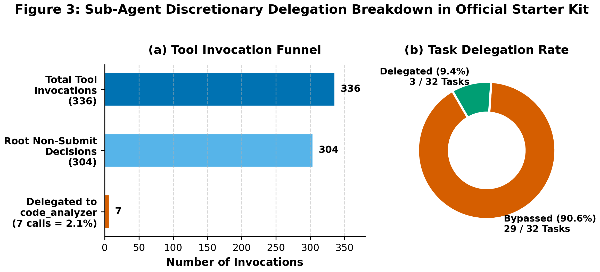
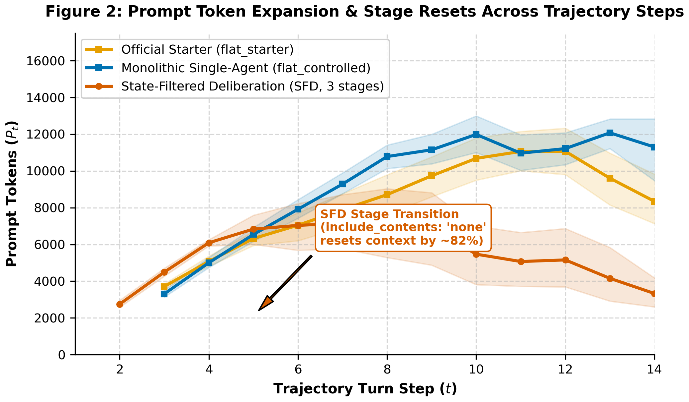

# ATIF-Gemma: Diagnostic Corpus and Failure Taxonomy for Small Developer Agents

**Author:** Karandeep Singh Sodhi  
**Competition:** Kaggle Gemma 4 Developer Agent Paper Competition (Best New Resource Track)  
**Artifact Repository:** https://github.com/KarandeepSinghSodhi/gemma-sfd-agent (Tag: `v1.0.0-camera-ready`)  
**Companion Architecture Paper:** [Sodhi (2026)](https://github.com/KarandeepSinghSodhi/gemma-sfd-agent/blob/main/KAGGLE_WRITEUP.md)

---

## Abstract

SWE-bench benchmarks typically report scalar resolution rates, obscuring multi-turn failure dynamics in small developer agents. Small models plateaued at low resolution (median 5.0% across 197 teams on the official Small Model Prize leaderboard). We introduce **ATIF-Gemma**, an open diagnostic corpus of 112 multi-turn execution traces across 32 SWE-bench tasks evaluating `gemma-4-e4b-it-qat-w4a16-ct` on 4x NVIDIA L4 GPUs across three controlled architectures (`flat_starter`, `flat_controlled`, `sfd`).

Standardized under ATIF v1.7 (Harbor Framework Contributors, 2026), ATIF-Gemma links agent actions to held-out test outcomes. Primary resolution is **6/96 (6.25%)** (2/32 per config, 95% Wilson CI [1.73%, 20.15%]; task cluster-bootstrap CI [1.04%, 12.50%]); pooled across 112 runs, resolution is 8/112 (7.14%). Across 26 complete-case tasks with valid outcomes for all configurations, each resolved 2/26 (7.69%, 95% CI [2.14%, 24.14%]; 6/78 overall, cluster-bootstrap CI [1.28%, 15.38%]). We classify four failure modes: assertion failures (50.0%, 56/112), collection crashes (32.1%, 36/112), budget exhaustion (8.0%, 9/112), and harness timeouts (2.7%, 3/112). Collection errors partition into agent syntax faults (16/36) versus sandbox defects (20/36; flagged `env_suspected=True`). Excluding suspected defects leaves 92 valid runs, yielding **6/80 (7.50%)** primary and **8/92 (8.70%)** pooled resolution. We release the corpus, the `atif_gemma` toolkit, and remediation patterns.

---

## 1. Introduction & The Diagnostic Vacuum in SWE Benchmarking

While frontier models resolve 30%–50% of SWE-bench issues (Jimenez et al., 2024; Yang et al., 2024), small developer agents ($\le 9\text{B}$) plateau below 10% (Holbrook, 2026). Standard benchmarks report pass/fail outcomes but obscure execution failures across localization, syntax, collection, and assertions. For quantized edge models (`gemma-4-e4b-it-qat-w4a16-ct`), ATIF-Gemma provides 112 standardized traces, a 4-tier failure taxonomy, a rerun determinism audit, and the `atif_gemma` diagnostic toolkit.

---

## 2. Related Work: Trajectory Corpora & Agent Diagnostics

### 2.1 SWE Agent Trajectories & Diagnostics
Prior SWE benchmarks evaluate scalar resolution on closed APIs or $\ge 32\text{B}$ models (Jimenez et al., 2024; Wang et al., 2024; Xia et al., 2024). SWE-smith (Yang et al., 2025) and SWE-Gym (Pan et al., 2024) scaled synthetic environments without dissecting failure traces of compact 4-bit edge models under test harnesses. Rajak (2026) released 50 Gemma 4 trajectories without Phase 2 outcome classification or schema validation. ATIF-Gemma provides 112 execution traces conforming to ATIF v1.7 (Harbor Framework Contributors, 2026), linking reasoning to container exit codes.

### 2.2 Small Open-Weight Developer Agents
Gemma 4 (Gemma Team, 2026) introduced edge models (`gemma-4-e4b-it-qat-w4a16-ct`) vulnerable to observation bloat (Lindenbauer et al., 2025). While our companion SFD paper (Sodhi, 2026) addressed prompt bloat across 16 tasks, ATIF-Gemma contributes the diagnostic corpus, failure taxonomy, and reproducibility audit across 32 tasks and 112 runs.

---

## 3. Corpus Architecture & ATIF v1.7 Schema Specifications

### Table 1: Composition of the ATIF-Gemma Diagnostic Corpus

| Corpus Partition | Traces | Tasks | LLM Calls | Tool Calls | Total Tokens |
| :--- | :---: | :---: | :---: | :---: | :---: |
| **Cohort 1 (Canonical)** | 24 | 8 | 304 | 265 | 2,270,463 |
| **Cohort 2 (Stratified Random)** | 24 | 8 | 339 | 298 | 2,720,322 |
| **Cohort 1 Rerun** | 16 | 8 | 204 | 172 | 1,387,758 |
| **Cohort 3 (Stratified Disjoint)** | 24 | 8 | 349 | 309 | 2,771,960 |
| **Cohort 4 (Stratified Disjoint)** | 24 | 8 | 322 | 284 | 2,555,675 |
| **Total ATIF-Gemma Corpus** | **112** | **32** | **1,518** | **1,328** | **11,706,178** |

*Note: Spans 32 unique tasks; Cohort 1 Rerun re-executes Cohort 1 for reproducibility.*

Covering 32 tasks across 4 repos (`fastapi`: 51, `rich`: 37, `requests`: 19, `httpx`: 5) on 4x NVIDIA L4 GPUs via vLLM (`tp=4`) hosting `gemma-4-e4b-it-qat-w4a16-ct` under Google ADK and `swegemma`, traces record tool arguments, deliberative thoughts (`extra.event_type: "thinking"`), token metrics, and Phase 2 exit codes.

**Schema Conformance, Datasheet & Governance (Gebru et al., 2021):** All 112 traces pass formal validation against our version-pinned ATIF v1.7 schema (`dataset_resource/atif_schema_v1_7.json`; Harbor Framework Contributors, 2026; `analysis/validate_atif_schema.py`). Following Gebru et al. (2021; full sheet in `dataset_resource/datasheet.md`):
- *Data Access & Licensing*: Under [Official Competition Rules](https://www.kaggle.com/competitions/gemma-4-developer-agent-paper/rules) Sections 1.7 & 2.4.a.1, participants *"may access and use the Competition Data for any purpose... including for academic research and education."* Repository tasks originate from open-source projects under MIT, Apache-2.0, and BSD-3-Clause licenses (`NOTICE`).
- *Data Security & Derived Labels (Rule 2.4.b.1)*: Rule 2.4.b.1 restricts Competition Data redistribution. ATIF-Gemma distributes only model-generated trajectories and metadata; proprietary `test_patch` files are strictly omitted. On the forum ([Topic 749803](https://www.kaggle.com/competitions/gemma-4-developer-agent-paper/discussion/749803)), Host Elan Markowitz confirmed: *"Yes, publishing derived labels is okay."* Gold-patch file lists serve solely as internal ground truth for derived localization tiers (`analysis/subclassify_exit1.py`) and are not redistributed. Step 0 problem statements derive from public issue descriptions. Traces: CC BY 4.0; companion code: Apache-2.0.
- *Dual-Submission Allowance (Rule 2.2.b)*: Rule 2.2.b states *"You may select up to two (2) Final Submissions for judging,"* and Host Elan Markowitz confirmed ([Topic 743255](https://www.kaggle.com/competitions/gemma-4-developer-agent-paper/discussion/743255)): *"A team can submit at most two write-ups. There is only one submission track, and the judges will determine the eligibility for each prize."* ATIF-Gemma serves as empirical companion to our SFD architecture paper (Sodhi, 2026), providing the diagnostic corpus, failure taxonomy, and reproducibility audit.

---

## 4. Failure Taxonomy & Phase 2 Outcome Breakdown

**Cross-Paper Concordance & Scope:** While the companion SFD paper (Sodhi, 2026) evaluated 16 paired tasks (Cohorts 1–2, 48 runs) grouped into three coarse categories (`resolved`, `test_verification_failed`, `timeout_or_budget_no_patch`), ATIF-Gemma evaluates 32 tasks across 5 cohorts (112 runs) mapped to exact Phase 2 container exit codes: (1) `resolved` maps to Exit 0 (8 pooled, 6 primary); (2) `timeout_or_budget_no_patch` maps to turn-budget exhaustion without patch generation (Exit -1, 9 runs); and (3) `test_verification_failed` maps to pytest collection crashes (Exit 2, 36 runs: 16 agent syntax vs 20 `env_suspected`), assertion failures (Exit 1, 56 runs: Tiers 1–4, including 6 zero-byte runs like `rich_3944` flat_starter), and verification timeouts (Exit 124, 3 runs).

### Table 2: Phase 2 Exit Code Failure Taxonomy Across 112 GPU Traces

| Category | Exit Code | Count (%) | Empirical Mechanism & Operational Diagnosis |
| :--- | :---: | :---: | :--- |
| **Resolved** | `0` | 8 (7.1%) | Patch applied cleanly; all pytest unit assertions passed with zero regressions. |
| **Assertion Failure** | `1` | 56 (50.0%) | Patch applied; pytest collected test suite, but $\ge 1$ assertion failed. |
| **Collection Crash** | `2` | 36 (32.1%) | Pytest crashed during test collection (syntax errors, missing modules, import shadowing). |
| **Turn Budget / No-Patch** | `-1` | 9 (8.0%) | Exhausted 30-turn budget without generating unified diff (0 patch characters). |
| **Harness Timeout** | `124` | 3 (2.7%) | Pytest execution exceeded container wall-clock limit (>120s execution timeout). |

### 4.1 Deterministic Mechanism Breakdown of Collection Errors (Exit Code 2: 36 Runs)
Nearly one-third of runs (36/112 = 32.1%) failed before unit tests executed (`analysis/classify_exit2.py`):
1. **Agent Causes (16/36 = 44.4%)**: Syntax/indentation corruption (13/36 across 7 tasks) and missing modules (3/36 on `rich_3930`).
2. **Environment Causes (20/36 = 55.6%; `env_suspected=True`)**: Path shadowing (10/36 on `httpx_3672`, `fastapi_15661`) and missing sandbox wheels (`inline_snapshot`, `dirty_equals` across 10 runs on 4 tasks). Gold-patch controls (`analysis/gold_patch_control.py`) require offline containers and remain future work.

Excluding 20 suspected sandbox defects leaves 92 valid runs (80 primary, 12 reruns). Across 26 complete-case tasks (78 paired runs), each configuration resolved 2/26 (7.69%, 95% Wilson CI [2.14%, 24.14%]; 6/78 overall, 95% cluster-bootstrap CI [1.28%, 15.38%]). No resolution difference is detectable (McNemar exact two-sided $p=1.000$; $\text{MDE} \approx 15\text{--}20$ percentage points at $80\%$ power, $\alpha=0.05$, requiring $\ge 4$ net discordant tasks on $N=26$). Across all 80 valid primary runs, resolution is **6/80 (7.50%, unadjusted 95% CI [3.48%, 15.41%])** (`flat_starter` 2/27, `flat_controlled` 2/27, `sfd` 2/26); pooled across 92 valid runs, resolution is **8/92 (8.70%, unadjusted 95% CI [4.47%, 16.23%])**.

### 4.2 Deterministic Sub-Classification of Assertion Failures (Exit Code 1: 56 Runs)
Exit Code 1 represents 50.0% of runs (56/112). A decision tree (`analysis/subclassify_exit1.py`) partitions all 56 assertion failures:
1. **Empty / Zero-Byte Patch (6/56 = 10.7%)**: $|F_{\text{agent}}| = 0$. Zero-byte diffs from tool errors (`rich_3043`, `rich_3944`), budget limits (`fastapi_14372`), or unattempted edits (`fastapi_5624`).
2. **Wrong-File Localization (15/56 = 26.8%)**: $F_{\text{agent}} \cap F_{\text{gold}} = \emptyset$ with applied diff (e.g. `fastapi_15589`).
3. **Partial Multi-File (14/56 = 25.0%)**: $|F_{\text{gold}}| > 1$ and $F_{\text{agent}} \subsetneq F_{\text{gold}}$ (e.g. `requests_7505`).
4. **Right-File, Wrong-Logic (21/56 = 37.5%)**: $F_{\text{agent}} \cap F_{\text{gold}} \neq \emptyset$. Correct files, but failed assertions (e.g. `rich_3471`).

*Caveat:* File overlap ($F_{\text{agent}} \cap F_{\text{gold}}$) serves as an automated structural proxy; alternative valid patches remain possible.

### 4.3 Ground-Truth Resolved Runs & Task Clustering
Across 112 runs, 8 resolved held-out tests across 4 tasks: `rich_4077` (3 runs), `fastapi_9753` (1), `fastapi_14077` (2), and `rich_3894` (2). In primary runs ($n=96$), 4/32 tasks (12.5%) resolved at least once; 0/32 resolved across all 3 configurations. Runs sharing tasks are clustered.

---

## 5. Quantitative Audit Across Agent Architectures

### Table 3: Architectural Comparison Across Primary (n=32) and Rerun (n=8) Cohorts

| Configuration | Runs | Primary Resolved (95% CI) | Mean Peak $P_t$ | Mean Cumulative Prompt | Mean Duration |
| :--- | :---: | :---: | :---: | :---: | :---: |
| **Official Starter (`flat_starter`)** | 32 | 2/32 (6.2%) [1.7%, 20.2%] | 13,359.7 | 105,817.6 | 94.2s |
| **Single-Agent (`flat_controlled`)** | 32 | 2/32 (6.2%) [1.7%, 20.2%] | 13,959.0 | 118,173.0 | 90.8s |
| **State-Filtered Deliberation (`sfd`)** | 32 | 2/32 (6.2%) [1.7%, 20.2%] | 10,907.5 | 80,375.7 | 86.6s |
| **Rerun: `flat_controlled`** | 8 | 1/8 (12.5%) [2.2%, 47.1%] | 12,557.5 | 93,135.6 | 107.4s |
| **Rerun: `sfd`** | 8 | 1/8 (12.5%) [2.2%, 47.1%] | 9,306.4 | 67,710.1 | 96.4s |

*Note:* Primary resolution reflects unadjusted outcomes across 32 tasks; complete-case analysis (2/26 per config, 6/78 overall) is in Section 4.1. **Peak $P_t$**: max prompt length. **Cumulative Prompt**: sum of input prompt tokens.

### 5.1 Statistical Tests & Resolution Invariance
Across 32 primary tasks, resolution shows identical marginal counts at 2/32 (6.25%, 95% Wilson CI [1.73%, 20.15%]) across `flat_starter`, `flat_controlled`, and `sfd` (McNemar $p = 1.0000$ for all pairs; 6/96 overall, 95% cluster-bootstrap CI [1.04%, 12.50%]). **No architecture demonstrates a resolution advantage.**

In contrast, SFD achieves significant token reductions over flat baselines across all 32 tasks:
- **Cumulative Prompt Tokens**: vs `flat_controlled`: **-37,797.4 (-32.0%)** (95% CI [-52,214.6, -23,755.2], Wilcoxon $p < 0.0001$; lower in 25/32); vs `flat_starter`: **-25,441.9 (-24.0%)** (95% CI [-42,485.1, -9,031.4], $p = 0.0061$; lower in 24/32).
- **Peak Prompt Tokens**: vs `flat_controlled`: **-3,051.6 (-21.9%)** (95% CI [-4,142.9, -1,968.2], $p < 0.0001$; lower in 28/32); vs `flat_starter`: **-2,452.2 (-18.4%)** (95% CI [-3,795.9, -1,111.8], $p = 0.0008$; lower in 26/32).
- **Cumulative Total Tokens**: vs `flat_controlled`: **-36,786.3 (-29.7%)** (95% CI [-51,715.4, -22,346.4], $p < 0.0001$); vs `flat_starter`: **-24,585.3 (-22.0%)** (95% CI [-41,948.3, -8,026.9], $p = 0.0073$).
- **Duration**: Differences are small (vs `flat_controlled`: -4.2s, -4.7%, $p = 0.4540$; vs `flat_starter`: -7.7s, -8.1%, $p = 0.4429$).

### 5.2 Rerun Reproducibility & Determinism Audit
Cohort 1 was re-executed across 8 tasks $\times$ 2 configs (16 paired runs; `analysis/statistical_tests.py`):
- **Exit Code Agreement**: 12/16 runs (75.0%) matched exact exit codes (4 flips: `rich_4077` ctrl 1->0; `fastapi_15588` sfd 1->2; `fastapi_15589` ctrl 1->2; `fastapi_15589` sfd -1->1).
- **Patch Presence Agreement**: 14/16 runs (87.5%) agreed on patch presence (8/8 `flat_controlled`, 6/8 `sfd`; discordances on `fastapi_15589`, `requests_7502`).
- **Normalized Edit-Operation Hash Agreement**: Normalized hashes of recorded edit-operation and patch payloads matched in 0/16 pairs (0.0%), indicating substantial run-to-run divergence in recorded edits despite greedy decoding ($T=0.0$).
- **Semantic Concordance Across Reruns**:
  - *Successful Resolution Convergence (`rich_4077`)*: All three resolved runs (`flat_controlled_rerun`, `sfd_orig`, `sfd_rerun`) converged to identical 3-line logic (`def isatty(self) -> bool: return self.__file.isatty()`), differing only by anchor (after line 18 `fileno()` vs before line 23 `write()`; diffs in `results/rich_4077_diffs.md`).
  - *Unresolved Edit Concordance (`requests_7505`)*: Across both `flat_controlled` runs on `requests_7505`, original and rerun applied the identical guard (`elif isinstance(fp, _SupportsRead): fdata = fp.read()`), differing only by comment lines in tool args. Both failed unit tests (Exit 1, Tier 3) because the task required an unattempted edit in `adapters.py`.
  - *Cohort-Wide Concordance*: Across all 16 rerun pairs, 10 pairs (62.5%) touched identical source files; 1 pair (`requests_7505` `flat_controlled`) matched 100% on normalized replacement code; and 0 pairs produced bitwise-identical final patches due to context lines and anchor positions.
- **Token Drift**: Mean absolute token difference was **18,571.0 total tokens** between pairs.

### 5.3 Sub-Agent Bypassing in the Starter Kit
In `flat_starter`, the root agent wraps `code_analyzer` as an `AgentTool`. Across 32 traces:
- Out of 336 tool calls, the model delegated to `code_analyzer` only **7 times (2.1%)**.
- The model **bypassed `code_analyzer` on 26 of 32 tasks (81.2%)**, reading files directly into root context (6/32 delegated).


*Figure 3: Sub-agent delegation in `flat_starter`: 81.2% bypassed delegation; 2.1% calls delegated.*

### 5.4 Cross-Stage Prompt Resets
In `sfd` traces, `include_contents: "none"` resets entry prompts from a mean TriageAgent peak of 10,473.9 tokens (median 9,863.0) to 1,536.9 tokens (median 1,503.0) at PatchAgent entry. Across 32 primary SFD runs, this yields an 81.95% mean prompt reset (median 87.43%, IQR [75.72%, 89.46%]), driving the 32.0% prompt reduction over flat baselines ($p < 0.0001$).


*Figure 2: Prompt trajectories across steps $t$ (mean with 95% bootstrap bands). Flat runs expand monotonically; SFD resets prompt tokens by 87.43% median.*

---

## 6. Candidate Remediations (Untested Unless Stated)

Diagnostic classifications suggest actionable engineering patterns for compact developer agents:

| Failure Mode | Prevalence | Candidate Remediation Pattern |
| :--- | :---: | :--- |
| **Collection / Path Crash** | 36/112 (32.1%) | Enforce `PYTHONPATH` priority and run pre-flight dependency checks. |
| **Edit-Tool Failures** | 100 errors (64 StringNotFound, 36 Malformed) | Validate edit targets against buffer state; handle failed edits explicitly. |
| **Syntax Corruption** | 13/112 runs (11.6%) | Mandate `py_compile` check before `submit_patch` with self-repair turns. |
| **Wrong-File Localization** | 15/112 (13.4% overall; 26.8% Exit 1) | Two-way symbol verification loop (untested) before editing. |
| **Unbounded Context Growth** | 64/64 flat runs (100% monotonic) | Stage context pruning (`include_contents: "none"`), resetting context 81.9% mean (reduces tokens; no resolution gain observed). |

### 6.1 Post-Hoc Diagnostic Evaluation (Non-Official Harness)
Offline diagnostic checks (`analysis/remediation_eval.py`, `results/remediation_eval.json`) do not alter official benchmarks:
1. **Pre-Submission `py_compile` Gate**: Catches 100% (13/13) of syntax-corrupted patches before `submit_patch` by construction; autonomous recovery without repair turns was 0/13.
2. **`PYTHONPATH` Priority**: Prepending repository source (`PYTHONPATH=/workspace/src:/workspace`) is predicted to avoid collection crashes across all 10 path-shadowed runs (`httpx_3672`, `fastapi_15661`). Semantic evaluation requires container execution; no speculative gains are claimed.

---

## 7. The `atif_gemma` Python Package & CLI

We release the standalone Python package `atif-gemma`:
```bash
pip install git+https://github.com/KarandeepSinghSodhi/gemma-sfd-agent.git
```
Modules provide trajectory auditing (`audit`), deterministic exit-code and localization classification (`taxonomy`), and remediations (`remediation`). CLI: `python -m atif_gemma.cli audit traces/` and `python -m atif_gemma.cli playbook`.

---

## 8. Limitations & Threats to Validity

1. **Task Sample ($n = 32$)**: Evaluates 25% of benchmark instances (>500 GPU hours for exhaustive runs).
2. **Model & Quantization**: Evaluates `gemma-4-e4b-it-qat-w4a16-ct` (INT4); larger models may differ.
3. **Repository Diversity**: Concentrated on 4 Python repos; runs sharing tasks are clustered.
4. **Non-Determinism**: Under $T=0.0$, 12/16 exit codes matched on rerun, but normalized edit hashes diverged (mean drift: 18,571 tokens).
5. **Structural Proxy**: File overlap ($F_\text{agent} \cap F_\text{gold}$) is a proxy; alternative valid patches remain possible.
6. **Sandbox Defects (`env_suspected=True`)**: 20 runs failed due to offline container limits (missing wheels, path shadowing).

---

## 9. Conclusion & Resource Availability

ATIF-Gemma demonstrates that raw resolution rates mask critical execution bottlenecks (50.0% assertion failures, 32.1% collection crashes). All 112 traces, metadata, and analysis tools are open-sourced:
- **GitHub Repository**: https://github.com/KarandeepSinghSodhi/gemma-sfd-agent (Tag: `v1.0.0-camera-ready`)
- **Kaggle Dataset**: `karandeepsinghsodhi/atif-gemma-swe-agent-traces`
- **Kaggle Notebook**: `karandeepsinghsodhi/atif-gemma-diagnostic-exploration`

---

## 10. References

- Austin, J., et al. (2021). Program Synthesis with Large Language Models. [*arXiv:2108.07732*](https://arxiv.org/abs/2108.07732)
- Chen, M., et al. (2021). Evaluating Large Language Models Trained on Code. [*arXiv:2107.03374*](https://arxiv.org/abs/2107.03374)
- Gebru, T., et al. (2021). Datasheets for Datasets. *Communications of the ACM*, 64(12), 86–92.
- Gemma Team. (2026). Gemma 4 Technical Report. [*arXiv:2607.02770*](https://arxiv.org/abs/2607.02770)
- Harbor Framework Contributors. (2026). Agent Trajectory Interchange Format (ATIF) Specification (v1.7). *GitHub*. [laude-institute/harbor](https://github.com/laude-institute/harbor)
- Holbrook, R. (2026). Google Gemma 4 Developer Agent Competition: Small Model Prize Leaderboard Snapshot. *Kaggle*. [Leaderboard](https://www.kaggle.com/competitions/gemma-4-developer-agent/leaderboard) (Snapshot: `results/small_model_leaderboard_2026_10_24.csv`, accessed October 24, 2026).
- Jimenez, C. E., et al. (2024). SWE-bench: Can Language Models Resolve Real-World GitHub Issues? *ICLR 2024*. [*arXiv:2310.06770*](https://arxiv.org/abs/2310.06770)
- Lindenbauer, T., et al. (2025). The Complexity Trap: Simple Observation Masking Is as Efficient as LLM Summarization for Agent Context Management. [*arXiv:2508.21433*](https://arxiv.org/abs/2508.21433)
- Pan, J., et al. (2024). Training Software Engineering Agents and Verifiers with SWE-Gym. [*arXiv:2412.21139*](https://arxiv.org/abs/2412.21139)
- Rajak, R. (2026). Gemma 4 TFD Agentic Trajectories & Benchmark: 50 multi-turn SWE-bench trajectories. *Kaggle Datasets*. [Benchmark](https://www.kaggle.com/datasets/rajarajak/gemma-4-tfd-agentic-trajectories-benchmark)
- Shinn, N., et al. (2023). Reflexion: Language Agents with Verbal Reinforcement Learning. *NeurIPS 2023*.
- Sodhi, K. S. (2026). State-Filtered Deliberation: Mitigating Multi-Turn Context Bloat in Small Developer Agents. *Kaggle Gemma 4 Developer Agent Paper Competition*. [Companion Paper](https://github.com/KarandeepSinghSodhi/gemma-sfd-agent/blob/main/KAGGLE_WRITEUP.md).
- Wang, X., et al. (2024). OpenHands: An Open Platform for AI Software Developers as Generalist Agents. [*arXiv:2407.16741*](https://arxiv.org/abs/2407.16741)
- Xia, C. S., et al. (2024). Agentless: Demystifying LLM-based Software Engineering Agents. [*arXiv:2407.01489*](https://arxiv.org/abs/2407.01489)
- Yang, J., et al. (2024). SWE-agent: Agent-Computer Interfaces Enable Automated Software Engineering. *NeurIPS 2024*. [*arXiv:2405.15793*](https://arxiv.org/abs/2405.15793)
- Yang, J., et al. (2025). SWE-smith: Scaling Data for Software Engineering Agents. [*arXiv:2504.21798*](https://arxiv.org/abs/2504.21798)
- Yao, S., et al. (2023). ReAct: Synergizing Reasoning and Acting in Language Models. *ICLR 2023*.
