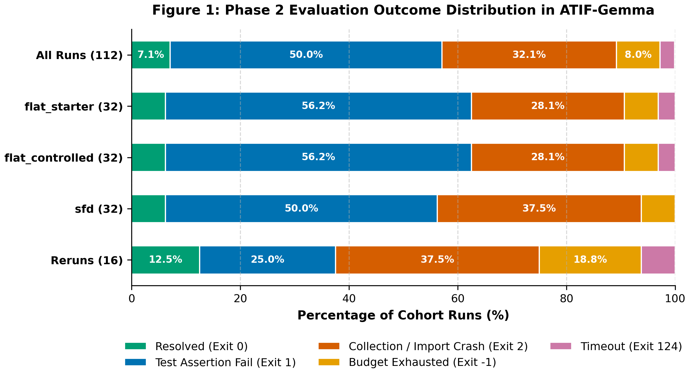

# ATIF-Gemma: Diagnostic Corpus and Failure Taxonomy for Small Developer Agents

**Author:** Karandeep Singh Sodhi (Independent Researcher)  
**Track:** Google — The Gemma 4 Developer Agent Competition (Paper Track: Best New Resource)  
**Dataset:** [ATIF-Gemma SWE Agent Traces (Kaggle)](https://www.kaggle.com/datasets/karandeepsinghsodhi/atif-gemma-swe-agent-traces) | **Code:** [gemma-sfd-agent (GitHub)](https://github.com/KarandeepSinghSodhi/gemma-sfd-agent)  
**Notebook:** [Diagnostic Exploration (Kaggle)](https://www.kaggle.com/code/karandeepsinghsodhi/atif-gemma-diagnostic-exploration) | **Manuscript:** [paper_resource.pdf](https://raw.githubusercontent.com/KarandeepSinghSodhi/gemma-sfd-agent/main/paper_resource.pdf)  

---

## Abstract

SWE-bench benchmarks typically report scalar task-resolution rates while discarding multi-turn execution trajectories, obscuring why developer agents fail. For compact 4-bit models (`gemma-4-e4b-it-qat-w4a16-ct`), diagnosing low resolution (median 5.0% across 197 teams on the Small Model Prize leaderboard; Holbrook, 2026) is hindered by limited public trace data linking small-agent trajectories to systematic failure diagnoses and held-out outcomes. We introduce **ATIF-Gemma**, an open empirical diagnostic corpus of 112 execution traces (1,518 LLM turns, 1,328 tool calls, 11,706,178 tokens) across 32 paired SWE-bench tasks on 4x NVIDIA L4 GPUs using Google ADK and `swegemma`. All tasks derive from public repositories under permissive open-source licenses (MIT, Apache-2.0, BSD-3-Clause in `NOTICE`; evaluation `test_patch` omitted per data governance rules).

Standardized under ATIF v1.7 (Harbor Framework Contributors, 2026), ATIF-Gemma cross-references fine-grained actions against held-out outcomes. Across the 26 tasks with valid environments across all configurations, each agent architecture resolved **2/26 tasks (7.69%, 95% Wilson CI [2.13%, 24.13%])**, yielding **6/78 resolved runs overall (7.69%, 95% task-level cluster-bootstrap CI [1.28%, 15.38%])**; across all 96 raw primary runs, resolution is 6/96 (6.25%, 2/32 per configuration). We establish a deterministic failure taxonomy: assertion failures (50.0%, 56/112), collection crashes (32.1%, 36/112; 55.6% attributed to sandbox defects, flagged `env_suspected`), budget exhaustion (8.0%, 9/112), and verification timeouts (2.7%, 3/112). We release the trace corpus, the `atif_gemma` package, and run-level diagnostic data.

---

## 1. Introduction & The Diagnostic Vacuum in SWE Benchmarking

Autonomous coding agents have advanced on SWE-bench (Jimenez et al., 2024), yet evaluation remains **outcome-centric**: reporting scalar pass rates while discarding multi-turn trajectories, prompt expansions, and sandbox interactions.

For compact 4-bit models (`gemma-4-e4b-it-qat-w4a16-ct`), this masks an acute capability cliff: on the Small Model Prize leaderboard (Holbrook, 2026), scores across 197 teams cluster near 5.0% (median 5.0%, mean 4.23%; 92.9% score $\le 6.0\%$). Without execution traces, developers cannot discern whether failures stem from localization drift, syntax corruption, environment defects, or tool exhaustion. We introduce **ATIF-Gemma**, an open diagnostic corpus and toolkit providing 112 standardized execution traces (11.7M tokens, 1,518 LLM turns, 1,328 tool calls) across 32 paired SWE-bench tasks under ATIF v1.7.

---

## 2. Related Work: Trajectory Corpora & Agent Diagnostics

### 2.1 SWE Agent Trajectories & Diagnostics
SWE-bench (Jimenez et al., 2024) benchmarked repository repair; SWE-agent (Yang et al., 2024) and OpenHands (Wang et al., 2024) introduced agent scaffolding, while ATIF v1.7 (Harbor Framework Contributors, 2026) standardized trajectory schemas. Large trajectory sets (SWE-Gym, SWE-smith; Pan et al., 2024; Yang et al., 2025) and Gemma corpora (Rajak, 2026) provide broad scale. In diagnostics, Xia et al. (2024) found multi-turn loops degrade performance, while Lindenbauer et al. (2025) showed observation masking matches summarization. ATIF-Gemma complements these via a dense paired diagnostic sample on compact 4-bit models, featuring deterministic failure classification, agent vs sandbox attribution, and linked test outcomes.

### 2.2 Small Open-Weight Developer Agents
Gemma 4 (Gemma Team, 2026) introduced edge models (`gemma-4-e4b-it-qat-w4a16-ct`). While small models excel on isolated code generation (Chen et al., 2021; Austin et al., 2021), repository repair exhibits an acute capability cliff (median 5.0% across 197 teams; Holbrook, 2026). ATIF-Gemma isolates whether this reflects reasoning capacity, context bloat, or sandbox crashes.

---

## 3. Corpus Architecture & ATIF v1.7 Schema Specifications

### Table 1: Composition of the ATIF-Gemma Diagnostic Corpus

| Corpus Partition | Traces | Tasks | LLM Calls | Tool Calls | Total Tokens |
| :--- | :---: | :---: | :---: | :---: | :---: |
| **Cohort 1 (Canonical)** | 24 | 8 | 304 | 265 | 2,270,463 |
| **Cohort 2 (Stratified Random)** | 24 | 8 | 339 | 298 | 2,720,322 |
| **Cohort 1 Rerun** | 16 | 8 | 204 | 172 | 1,387,758 |
| **Cohort 3 (Stratified Disjoint)** | 24 | 8 | 349 | 309 | 2,771,960 |
| **Cohort 4 (Stratified Disjoint)** | 24 | 8 | 322 | 284 | 2,555,675 |
| **Total ATIF-Gemma Corpus** | **112** | **32** | **1,518** | **1,328** | **11,706,178** |

*Note: Spans 32 unique tasks; Cohort 1 Rerun re-executes Cohort 1 for reproducibility.*

The corpus covers 32 instances across 4 repositories (`fastapi`: 51, `rich`: 37, `requests`: 19, `httpx`: 5) on 4x NVIDIA L4 GPUs via vLLM (`tp=4`) hosting `gemma-4-e4b-it-qat-w4a16-ct` under Google ADK 1.36.1 and `swegemma`. Traces record `instance_id`, step metrics, tool calls, observations, deliberative reasoning (`extra.event_type: "thinking"`), duration, and Phase 2 exit codes.

**Schema Conformance, Datasheet & Governance (Gebru et al., 2021):** All 112 traces pass formal validation against our version-pinned ATIF v1.7 schema (`dataset_resource/atif_schema_v1_7.json`; Harbor Framework Contributors, 2026; audit via `analysis/validate_atif_schema.py`). Following Gebru et al. (2021; full sheet in `dataset_resource/datasheet.md`):
- *Data Access & Licensing*: Under Official Competition Rules Section 1.7 and Section 2.4.a.1, participants *"may access and use the Competition Data for any purpose, whether commercial or non-commercial, including for participating in the Competition and on Kaggle.com forums, and for academic research and education."* All evaluated repository tasks originate from public open-source projects under MIT, Apache-2.0, and BSD-3-Clause licenses (documented in `NOTICE`).
- *Data Security (Rule 2.4.b.1)*: To comply strictly with non-redistribution requirements for competition assets, ATIF-Gemma distributes only model-generated execution trajectories, tool-call arguments, and metadata; proprietary evaluation test patches (`test_patch`) are strictly omitted. Traces are licensed under CC BY 4.0; companion code under Apache-2.0.
- *Dual-Submission Differentiation (Rule 2.2.b)*: Competition Rule 2.2.b and organizers confirm participants may submit up to two final writeups. ATIF-Gemma serves as the companion empirical resource to our architectural investigation of State-Filtered Deliberation (SFD; Sodhi, 2026). While SFD addresses the prompt-bloat mechanism, ATIF-Gemma contributes the diagnostic trace corpus, failure taxonomy, and reproducibility audit.

---

## 4. Failure Taxonomy & Phase 2 Outcome Breakdown

In SWE-bench, patch verification runs in an isolated sandbox with `pytest`. Cross-referencing traces against Phase 2 outputs reveals distinct failure mechanics:

### Table 2: Phase 2 Exit Code Failure Taxonomy Across 112 GPU Traces

| Category | Exit Code | Count (%) | Empirical Mechanism & Observable Symptoms |
| :--- | :---: | :---: | :--- |
| **Resolved** | `0` | 8 (7.1%) | Passes held-out tests with zero regressions (6/96 primary, 6.3%). |
| **Assertion Failure** | `1` | 56 (50.0%) | Executes under pytest, but fails assertions due to logic or partial edits. |
| **Collection Error** | `2` | 36 (32.1%) | Pytest crashes during collection before assertion evaluation (syntax/path). |
| **Budget / Timeout** | `-1` | 9 (8.0%) | Agent exhausted 15 tool calls or 2.5 min wall time; 0 patch characters submitted. |
| **Verification Timeout** | `124` | 3 (2.7%) | Harness timed out (120s limit) due to daemon process or infinite loop. |


*Figure 1: Phase 2 evaluation outcomes across all 112 ATIF-Gemma runs (Okabe-Ito palette).*

### 4.1 Deterministic Mechanism Breakdown of Collection Errors (Exit Code 2: 36 Runs)
Nearly one-third of runs (36/112 = 32.1%) failed before unit tests executed. Deterministic classification (`analysis/classify_exit2.py`) separates agent from environment causes:

1. **Agent Causes (16/36 = 44.4%)**: Syntax/indentation corruption (13/36 = 36.1% across 7 tasks) and missing source modules (3/36 = 8.3% on `rich_3930`).
2. **Environment Causes (20/36 = 55.6%; `env_invalid=True`)**: Path shadowing (10/36 = 27.8% on `httpx_3672`, `fastapi_15661`) and missing sandbox wheels (`inline_snapshot`, `dirty_equals` across 10 runs on 4 tasks). We could not run a gold-patch control locally without the offline Phase 2 container; executing this oracle control (`analysis/gold_patch_control.py`) remains future work.

Excluding the 20 environment-invalid runs leaves 92 valid runs (80 primary, 12 reruns). Among primary runs, 26 tasks have valid outcomes across all three configurations (78 complete-case runs). In this paired complete-case subset, each configuration resolved 2/26 tasks (7.69%, 95% Wilson CI [2.13%, 24.13%]), yielding 6/78 resolved runs overall (7.69%, 95% task-level cluster-bootstrap CI [1.28%, 15.38%]). These identical marginal counts serve as our primary inferential result (specific tasks resolved differ between configurations). Across all 80 primary valid runs, resolution is **6/80 (7.50%, unadjusted run-level 95% CI [3.48%, 15.41%])** (`flat_starter` 2/27, `flat_controlled` 2/27, `sfd` 2/26); pooled across all 92 valid runs, it is **8/92 (8.70%, unadjusted run-level 95% CI [4.47%, 16.23%])**.

### 4.2 Deterministic Sub-Classification of Assertion Failures (Exit Code 1: 56 Runs)
Exit Code 1 represents 50.0% of the corpus (56/112). A mutually exclusive decision tree (`analysis/subclassify_exit1.py`) partitions all 56 assertion failures:
1. **Empty / Zero-Byte Patch (6/56 = 10.7%)**: $|F_{\text{agent}}| = 0$. Zero-byte diffs from no attempted edits (`fastapi_5624`), tool errors (`rich_3043`, `rich_3944`, `requests_7502`), or budget limits before edits (`fastapi_14372`, `requests_7315`).
2. **Wrong-File Localization (15/56 = 26.8%)**: $F_{\text{agent}} \cap F_{\text{gold}} = \emptyset$ with applied diff (e.g., `fastapi_15589`).
3. **Partial Multi-File Localization (14/56 = 25.0%)**: $|F_{\text{gold}}| > 1$ and $F_{\text{agent}} \subsetneq F_{\text{gold}}$ (e.g., `requests_7505`).
4. **Right-File, Wrong-Logic (21/56 = 37.5%)**: $F_{\text{agent}} \cap F_{\text{gold}} \neq \emptyset$. Localized correct files, but logic failed assertions (e.g., `rich_3471`, `requests_7427`).

*Caveat:* File overlap ($F_{\text{agent}} \cap F_{\text{gold}}$) serves as an automated structural proxy; alternative valid patches remain possible.

### 4.3 Ground-Truth Resolved Runs & Task Clustering
Across 112 runs, 8 resolved held-out tests across 4 tasks: `rich_4077` (3 runs), `fastapi_9753` (1), `fastapi_14077` (2), and `rich_3894` (2). In primary runs ($n=96$), 4/32 tasks (12.5%) resolved at least once; 0/32 resolved across all 3 configurations. Runs sharing tasks are clustered.

---

## 5. Quantitative Audit Across Agent Architectures

### Table 3: Architectural Comparison Across Primary (n=32) and Rerun (n=8) Cohorts

| Configuration | Runs | Primary Resolved (95% CI) | Mean Peak $P_t$ | Mean Cumulative Prompt | Mean Duration |
| :--- | :---: | :---: | :---: | :---: | :---: |
| **Official Starter (`flat_starter`)** | 32 | 2/32 (6.2%) [1.7%, 20.2%] | 13,359.7 | 105,817.6 | 94.2s |
| **Single-Agent (`flat_controlled`)** | 32 | 2/32 (6.2%) [1.7%, 20.2%] | 13,959.0 | 118,173.0 | 90.8s |
| **State-Filtered Deliberation (`sfd`)** | 32 | 2/32 (6.2%) [1.7%, 20.2%] | 10,907.5 | 80,375.7 | 86.6s |
| **Rerun: `flat_controlled`** | 8 | 1/8 (12.5%) [2.2%, 47.1%] | 12,557.5 | 93,135.6 | 107.4s |
| **Rerun: `sfd`** | 8 | 1/8 (12.5%) [2.2%, 47.1%] | 9,306.4 | 67,710.1 | 96.4s |

*Note:* Primary-run resolution rates reflect unadjusted raw outcomes across all 32 tasks, including environment-invalid runs; complete-case sensitivity analysis on valid runs (2/26 per config, 6/78 overall) is reported in Section 4.1. **Mean Peak $P_t$**: maximum prompt length reaching context across turns $t$. **Mean Cumulative Prompt**: sum of input prompt tokens across LLM calls.

### 5.1 Statistical Tests & Resolution Invariance
Across 32 primary tasks, resolution shows identical marginal counts at 2/32 (6.25%, 95% Wilson CI [1.73%, 20.15%]) across `flat_starter`, `flat_controlled`, and `sfd` (McNemar $p = 1.0000$ for all pairs; 6/96 overall, 95% cluster-bootstrap CI [1.04%, 13.54%]), though resolved tasks differ. **No architecture demonstrates a resolution advantage.**

In contrast, SFD produces significant token reductions:
- **Cumulative Prompt Tokens**: SFD consumes 37,797.4 fewer prompt tokens vs `flat_controlled` (-32.0%, 95% bootstrap CI `[-52,214.6, -23,755.2]`, Wilcoxon $p < 0.0001$; lower on 25/32 tasks) and 25,441.9 fewer vs `flat_starter` (-24.0%, CI `[-42,485.1, -9,031.4]`, $p = 0.0061$; lower on 24/32 tasks).
- **Peak Prompt Tokens ($P_t$)**: SFD reduces peak prompt by 3,051.6 tokens vs `flat_controlled` (-21.9%, CI `[-4,142.9, -1,968.2]`, $p < 0.0001$; lower on 28/32 tasks) and by 2,452.2 vs `flat_starter` (-18.4%, CI `[-3,795.9, -1,111.8]`, $p = 0.0008$; lower on 26/32 tasks).
- **Duration**: Duration differences (-4.2s vs controlled, -7.7s vs starter) are not statistically significant ($p = 0.454, 0.443$).

### 5.2 Rerun Reproducibility & Determinism Audit
Cohort 1 was re-executed across 8 tasks $\times$ 2 configs (16 paired runs; `analysis/statistical_tests.py`):
- **Exit Code Agreement**: 12 of 16 runs (75.0%) matched exact exit codes.
- **Patch Presence Agreement**: 14 of 16 runs (87.5%) agreed on patch presence (8/8 in `flat_controlled`, 6/8 in `sfd`). (Earlier drafts mislabeled this as patch identity; 14/16 denotes whether a patch was generated). Discordances: `fastapi_15589` (sfd: timeout vs 590 chars) and `requests_7502` (sfd: 581 chars vs 0 bytes from edit errors).
- **Final Patch & Edit Identity (SHA-256)**: 0 of 16 pairs (0.0%) produced bitwise-identical final patches or edit sequences under greedy decoding ($T=0.0$), demonstrating serving-level trajectory divergence.
- **Exit-Code Flips (4 pairs)**: `rich_4077` (ctrl: 1->0 resolved); `fastapi_15588` (sfd: 1->2); `fastapi_15589` (ctrl: 1->2); `fastapi_15589` (sfd: -1->1).
- **Token Drift**: Mean absolute token difference was **18,571.0 cumulative tokens** between paired runs ($|\text{tokens}_{\text{rerun}} - \text{tokens}_{\text{orig}}|$ across 16 pairs), quantifying multi-turn divergence.

### 5.3 Sub-Agent Bypassing in the Starter Kit
In the official starter kit (`flat_starter`), the root agent wraps `code_analyzer` as an `AgentTool`. Across all 32 traces:
- Out of 336 tool calls, the model delegated to `code_analyzer` only **7 times (2.1%)**.
- The model **bypassed `code_analyzer` on 26 of 32 tasks (81.2%)**, reading files directly into root context (6/32 delegated).


*Figure 3: Sub-agent delegation in `flat_starter`: 81.2% tasks bypassed delegation, with 2.1% calls delegating.*

### 5.4 Cross-Stage Prompt Resets
In `sfd` traces, `include_contents: "none"` resets entry prompts from a mean TriageAgent peak of 10,473.9 tokens (median 9,863.0) to 1,536.9 tokens (median 1,503.0) at PatchAgent entry. Across 32 primary SFD runs, this yields an 81.95% mean prompt reset (median 87.43%, IQR [75.72%, 89.46%]), driving the 32.0% prompt token reduction over single-agent baselines ($p < 0.0001$).


*Figure 2: Prompt trajectories across steps $t$ (mean with 95% bootstrap bands). Flat runs expand monotonically; SFD resets prompt tokens by 87.43% median.*

---

## 6. Candidate Remediations (Untested Unless Stated)

Diagnostic classifications suggest actionable engineering patterns for compact developer agents:

| Failure Mode | Prevalence | Candidate Remediation Pattern |
| :--- | :---: | :--- |
| **Collection / Path Crash** | 36/112 (32.1%) | Enforce `PYTHONPATH` priority and run pre-flight dependency checks. |
| **Edit-Tool Failures** | 100 errors (64 StringNotFound, 36 Malformed) | Validate edit targets against buffer state; handle failed edits explicitly. |
| **Syntax Corruption** | 13/112 runs (11.6%) | Mandate `py_compile` check before `submit_patch` with self-repair turns. |
| **Wrong-File Localization** | 15/112 (13.4% overall; 26.8% Exit 1) | Two-way symbol verification loop (untested) before editing. |
| **Unbounded Context Growth** | 64/64 flat runs (100% monotonic) | Stage context pruning (`include_contents: "none"`), resetting context 81.9% mean. |

### 6.1 Post-Hoc Diagnostic Evaluation (Non-Official Harness)
We conducted offline diagnostic checks of stored patches (`analysis/remediation_eval.py`, `results/remediation_eval.json`). **These checks do not alter official benchmarks in Section 4 and Tables 1-3.**

1. **Pre-Submission `py_compile` Gate**: Automated `py_compile` catches 100% (13/13) of syntax-corrupted patches before `submit_patch` by construction. It does not prove autonomous recovery without repair turns (0/13 resolved without re-prompting).
2. **`PYTHONPATH` Priority**: Prepending repository source (`PYTHONPATH=/workspace/src:/workspace`) is predicted to avoid collection crashes across all 10 path-shadowed runs (`httpx_3672`, `fastapi_15661`). Evaluating semantic success requires container execution; no speculative gains are claimed.

---

## 7. The `atif_gemma` Python Package & CLI

We release the standalone Python package `atif-gemma`:

```bash
pip install git+https://github.com/KarandeepSinghSodhi/gemma-sfd-agent.git
```

Modules provide automated trajectory auditing (`audit`), deterministic exit-code and localization classification (`taxonomy`), and the actionable playbook (`remediation`). The CLI provides instant diagnostics: `python -m atif_gemma.cli audit traces/` and `python -m atif_gemma.cli playbook`.

---

## 8. Limitations & Threats to Validity

1. **Task Sample Size ($n = 32$)**: Covers 25% of 129 benchmark instances; running all across 3 configurations requires >500 GPU hours.
2. **Single Model & Quantization**: Evaluates `gemma-4-e4b-it-qat-w4a16-ct` (INT4); larger models (31B) may exhibit different error dynamics.
3. **Repository Diversity & Clustering**: Concentrated across 4 Python repositories; runs sharing tasks are clustered.
4. **Trajectory Non-Determinism**: Under greedy decoding ($T=0.0$), 12/16 exit codes matched on rerun, but normalized edit hashes diverged across the 16 pairs (mean token difference: 18,571 tokens).
5. **Structural Proxy**: Evaluates file overlap ($F_\text{agent} \cap F_\text{gold}$); valid alternative patch locations remain possible.
6. **Container Failures (`env_suspected=True`)**: 20 runs failed due to offline sandbox constraints (missing wheels, path shadowing).

---

## 9. Conclusion & Resource Availability

ATIF-Gemma provides an open diagnostic foundation for compact developer agents. Moving beyond scalar metrics to an open 112-trace corpus, a failure taxonomy, a remediation playbook, and open tooling, this resource isolates key compact-agent bottlenecks: collection crashes, context bloat, and localization drift.

- **Kaggle Dataset:** [ATIF-Gemma SWE Agent Traces](https://www.kaggle.com/datasets/karandeepsinghsodhi/atif-gemma-swe-agent-traces) (CC BY 4.0)  
- **GitHub Repository:** [gemma-sfd-agent](https://github.com/KarandeepSinghSodhi/gemma-sfd-agent) (Apache 2.0)  
- **Interactive Kernel:** [Diagnostic Exploration](https://www.kaggle.com/code/karandeepsinghsodhi/atif-gemma-diagnostic-exploration)  
- **Manuscript PDF:** [paper_resource.pdf](https://raw.githubusercontent.com/KarandeepSinghSodhi/gemma-sfd-agent/main/paper_resource.pdf)

---

## 10. References

- Austin, J., et al. (2021). Program synthesis with large language models. *arXiv:2108.07732*.
- Chen, M., et al. (2021). Evaluating large language models trained on code. *arXiv:2107.03374*.
- Gebru, T., et al. (2021). Datasheets for datasets. *CACM*, 64(12), 86–92.
- Gemma Team. (2026). Gemma 4 Technical Report. *arXiv:2607.02770*. https://arxiv.org/abs/2607.02770
- Harbor Framework Contributors. (2026). ATIF Specification (v1.7). *GitHub*. https://github.com/harbor-framework/harbor
- Holbrook, R. (2026). Gemma 4 Developer Agent Competition: Small Model Prize Leaderboard. *Kaggle*. https://www.kaggle.com/competitions/gemma-4-developer-agent/leaderboard
- Jimenez, C. E., et al. (2024). SWE-bench: Can language models resolve real-world GitHub issues? *ICLR 2024*.
- Lindenbauer, T., et al. (2025). The Complexity Trap: Simple observation masking is as efficient as LLM summarization for agent context management. *arXiv:2508.21433*.
- Pan, J., Wang, X., Neubig, G., Jaitly, N., Ji, H., Suhr, A., & Zhang, Y. (2024). Training Software Engineering Agents and Verifiers with SWE-Gym. *arXiv:2412.21139*. https://arxiv.org/abs/2412.21139
- Rajak, R. (2026). Gemma 4 TFD Agentic Trajectories & Benchmark: 50 multi-turn SWE-bench trajectories. *Kaggle Datasets*. https://www.kaggle.com/datasets/rajarajak/gemma-4-tfd-agentic-trajectories-benchmark
- Wang, X., et al. (2024). OpenHands: An open platform for AI software developers. *arXiv:2407.16741*.
- Xia, C. S., et al. (2024). Agentless: Demystifying LLM-based software engineering agents. *arXiv:2407.01489*.
- Yang, J., et al. (2024). SWE-agent: Agent-computer interfaces enable automated SWE. *NeurIPS 2024*.
- Yang, J., et al. (2025). SWE-smith: Scaling data for software engineering agents. *arXiv:2504.21798*.
